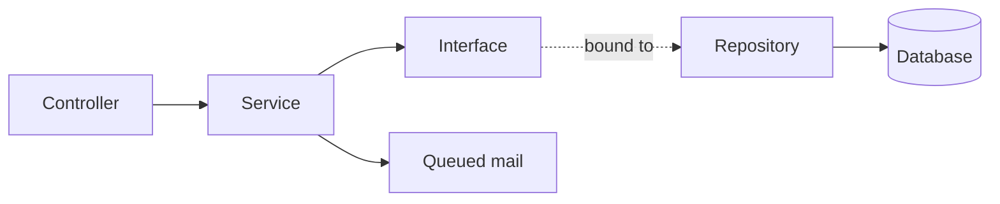
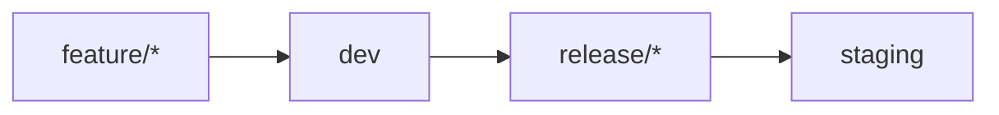

[🇹🇷 Türkçe](README.md) | 🇬🇧 English

# YapıMarket — Architecture Showcase

A full-stack e-commerce platform for building materials, built with Laravel 12. This repository is a curated, public extract of a private codebase. It shows how the order, pricing and catalog domains are designed without publishing the complete product.

> This is a selected source extract, not a runnable application. Configuration, customer data, assets and most of the UI are intentionally left out.

## Overview

YapıMarket covers the whole store workflow in a single application:

- **Storefront:** Category browsing, product filters, search, cart, coupons, checkout and order tracking.
- **Admin panel:** Product, category, filter, order, coupon, message and legal page management.
- **Operations:** PDF invoices, transactional email and order analytics.

## Features

| Area | What it does |
| --- | --- |
| **Catalog** | Category-specific filters, product attributes, specs, badges and daily deals |
| **SKU generation** | Builds SKUs from the product name, brand and the filters marked for SKU use |
| **Pricing** | Stores category tax rates, base price, tax amount and commission separately |
| **Checkout** | Recalculates totals on the server and validates stock inside a transaction |
| **Coupons** | Percentage or fixed discounts, with expiry dates and optional product scope |
| **Orders** | Six-state lifecycle, customer tracking and self-service cancellation with stock restore |
| **Invoices** | PDF invoices with dedicated numbering, sent to customers by email |
| **Contact inbox** | Read tracking, admin replies and soft deletes |
| **Legal pages** | Editable privacy, KVKK, terms, delivery, distance sales and cookie pages |
| **SEO** | Generated XML sitemap for active categories and products |

## Tech stack

| Layer | Technology |
| --- | --- |
| Backend | PHP 8.2+, Laravel 12 |
| Frontend | Blade, Vite 7, Tailwind CSS 4 |
| PDF | barryvdh/laravel-dompdf |
| HTML sanitizing | HTML Purifier |
| Background work | Laravel queues for email delivery |
| Developer tooling | Laravel Pint, Pail, Sail, Boost, Pest |

## Architecture

Controllers stay thin. Business rules live in services, and database access sits behind repository interfaces bound in the service container.



```text
app/
├── Enums/          # Order status, category status, product badge
├── Helpers/        # HTML sanitizing
├── Http/
│   └── Controllers/
│       ├── backend/    # Admin panel
│       └── frontend/   # Storefront
├── Interfaces/     # Repository contracts
├── Mail/           # Order, invoice and contact emails
├── Models/
├── Providers/      # Interface-to-repository bindings
├── Repositories/   # Database access
└── Services/       # Business rules
```

## How checkout works

`OrderService::placeOrder()` runs the order inside one database transaction, so an order can't be left half-written.

1. **Lock:** Requested products are loaded with `lockForUpdate()`, which stops concurrent orders from overselling the same stock.
2. **Validate:** Each item is checked for availability and stock quantity.
3. **Price:** The subtotal and discount are calculated from database prices. The client sends only product slugs and quantities.
4. **Create:** The order is saved, along with a snapshot of each product's name, SKU, image and price. Later catalog edits don't change past orders.
5. **Finalize:** Stock is decremented, and order and invoice numbers are generated from the order ID.
6. **Notify:** After the transaction commits, the confirmation email is queued, so a mail failure can't roll back a valid order.

Cancellation follows the same rule. It is allowed only while an order is `paid` or `processing`, and the status change and stock restore run in one transaction.

## Security

- **Rate limiting:** Each sensitive endpoint has its own limit.

| Endpoint | Limit per minute |
| --- | --- |
| Public pages | 120 |
| Search | 30 |
| Coupon check | 15 |
| Checkout, order lookup, contact form, login | 10 |
| Order cancellation | 5 |

- **XSS protection:** Admin-authored HTML is filtered through an HTML Purifier allowlist of tags, attributes and URL schemes.
- **Order privacy:** Tracking requires both the order number and the email address.
- **Admin access:** All admin routes sit behind the `auth` middleware.

## Development process

The project follows a Git Flow style workflow:



Each change is developed on its own feature branch, grouped into a versioned release and merged into staging. The project has reached v1.1.1 through a series of versioned releases.

## Project status

- **Payments:** Checkout currently records orders as paid. A payment provider isn't integrated yet.
- **Tests:** Pest is set up, but automated coverage is still to be written.

## Repository contents

| File | Why it's included |
| --- | --- |
| `app/Services/OrderService.php` | Transactional checkout and cancellation |
| `app/Repositories/OrderRepository.php` | Row locking and stock updates |
| `app/Interfaces/OrderInterface.php` | Repository contract |
| `app/Services/CouponService.php` | Discount calculation |
| `app/Enums/OrderStatus.php` | Order lifecycle |
| `app/Helpers/HtmlHelper.php` | HTML sanitizing |
| `app/Providers/AppServiceProvider.php` | Dependency bindings |

## Scope and reuse

This repository doesn't contain the full application, its environment configuration, customer data or production infrastructure. No license is granted, so all rights are reserved unless stated otherwise.
