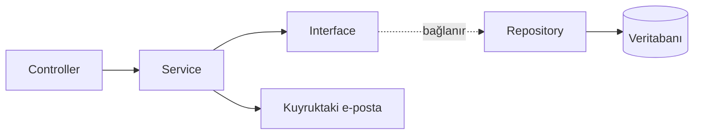

🇹🇷 Türkçe | [🇬🇧 English](README.en.md)

# YapıMarket — Mimari Vitrini

Laravel 12 ile geliştirilmiş, yapı malzemeleri odaklı full-stack bir e-ticaret platformu. Bu repo, özel bir kod tabanından seçilmiş herkese açık bir bölümdür. Ürünün tamamını yayınlamadan sipariş, fiyatlandırma ve katalog alanlarının nasıl tasarlandığını gösterir.

> Bu repo çalıştırılabilir bir uygulama değil, seçilmiş kaynak kodlardan oluşan bir vitrindir. Yapılandırma dosyaları, müşteri verileri, görseller ve arayüzün büyük bölümü bilinçli olarak dışarıda bırakılmıştır.

## Genel Bakış

YapıMarket, mağazanın tüm iş akışını tek bir uygulamada toplar:

- **Mağaza:** Kategori gezintisi, ürün filtreleri, arama, sepet, kupon, ödeme adımı ve sipariş takibi.
- **Yönetim paneli:** Ürün, kategori, filtre, sipariş, kupon, mesaj ve yasal sayfa yönetimi.
- **Operasyon:** PDF fatura, işlem e-postaları ve sipariş analitiği.

## Özellikler

| Alan | Ne yapıyor? |
| --- | --- |
| **Katalog** | Kategoriye özel filtreler, ürün nitelikleri, teknik özellikler, rozetler ve günün fırsatları |
| **SKU üretimi** | Ürün adı, marka ve SKU için işaretlenen filtrelerden stok kodu oluşturur |
| **Fiyatlandırma** | Kategori vergi oranlarını, baz fiyatı, vergi tutarını ve komisyonu ayrı ayrı tutar |
| **Ödeme adımı** | Tutarları sunucuda yeniden hesaplar, stoğu veritabanı işlemi içinde doğrular |
| **Kuponlar** | Son kullanma tarihi ve isteğe bağlı ürün kapsamıyla yüzde ya da sabit tutarlı indirim |
| **Siparişler** | Altı durumlu yaşam döngüsü, müşteri takibi ve stoğu geri yükleyen sipariş iptali |
| **Faturalar** | Ayrı numaralandırmalı PDF fatura ve e-posta ile gönderim |
| **İletişim kutusu** | Okundu takibi, yönetici yanıtları ve geri alınabilir silme |
| **Yasal sayfalar** | Düzenlenebilir gizlilik, KVKK, kullanım koşulları, teslimat, mesafeli satış ve çerez sayfaları |
| **SEO** | Aktif kategori ve ürünler için otomatik XML site haritası |

## Teknolojiler

| Katman | Teknoloji |
| --- | --- |
| Backend | PHP 8.2+, Laravel 12 |
| Frontend | Blade, Vite 7, Tailwind CSS 4 |
| PDF | barryvdh/laravel-dompdf |
| HTML temizleme | HTML Purifier |
| Arka plan işleri | E-posta gönderimi için Laravel kuyrukları |
| Geliştirme araçları | Laravel Pint, Pail, Sail, Boost, Pest |

## Mimari

Controller'lar ince tutulur. İş kuralları servislerde yer alır, veritabanı erişimi ise servis konteynerine bağlanan repository arayüzlerinin arkasındadır.



```text
app/
├── Enums/          # Sipariş durumu, kategori durumu, ürün rozeti
├── Helpers/        # HTML temizleme
├── Http/
│   └── Controllers/
│       ├── backend/    # Yönetim paneli
│       └── frontend/   # Mağaza
├── Interfaces/     # Repository sözleşmeleri
├── Mail/           # Sipariş, fatura ve iletişim e-postaları
├── Models/
├── Providers/      # Arayüz-repository bağlamaları
├── Repositories/   # Veritabanı erişimi
└── Services/       # İş kuralları
```

## Sipariş Akışı

`OrderService::placeOrder()` siparişi tek bir veritabanı işlemi içinde yürütür, böylece sipariş yarım kalamaz.

1. **Kilitleme:** İstenen ürünler `lockForUpdate()` ile yüklenir. Bu, eş zamanlı siparişlerin aynı stoğu aşırı satmasını önler.
2. **Doğrulama:** Her ürün için erişilebilirlik ve stok miktarı kontrol edilir.
3. **Fiyatlandırma:** Ara toplam ve indirim veritabanındaki fiyatlardan hesaplanır. İstemci yalnızca ürün slug'ını ve adedini gönderir.
4. **Oluşturma:** Sipariş, her ürünün adı, SKU'su, görseli ve fiyatının anlık kopyasıyla kaydedilir. Sonraki katalog düzenlemeleri geçmiş siparişleri değiştirmez.
5. **Tamamlama:** Stok düşülür, sipariş ve fatura numaraları sipariş ID'sinden üretilir.
6. **Bildirim:** İşlem tamamlandıktan sonra onay e-postası kuyruğa alınır. Böylece e-posta hatası geçerli bir siparişi geri alamaz.

İptal de aynı kurala uyar. Yalnızca `paid` ya da `processing` durumundaki siparişler iptal edilebilir. Durum değişikliği ve stok iadesi tek işlemde yapılır.

## Güvenlik

- **İstek sınırlama:** Her hassas uç noktanın kendi sınırı vardır.

| Uç nokta | Dakikalık sınır |
| --- | --- |
| Herkese açık sayfalar | 120 |
| Arama | 30 |
| Kupon kontrolü | 15 |
| Ödeme, sipariş sorgulama, iletişim formu, giriş | 10 |
| Sipariş iptali | 5 |

- **XSS koruması:** Yöneticinin girdiği HTML, izin verilen etiket, nitelik ve URL şemalarını tanımlayan HTML Purifier listesinden geçirilir.
- **Sipariş gizliliği:** Takip için hem sipariş numarası hem e-posta adresi gerekir.
- **Yönetici erişimi:** Tüm yönetim rotaları `auth` middleware'inin arkasındadır.

## Geliştirme Süreci

Proje, Git Flow tarzı bir iş akışı izler:


Her değişiklik kendi feature dalında geliştirilir, sürümlü bir release içinde toplanır ve staging dalına birleştirilir. Proje, ardışık sürümlerle v1.1.1'e ulaşmıştır.

## Proje Durumu

- **Ödeme:** Ödeme adımı siparişleri şu an ödendi olarak kaydediyor. Henüz bir ödeme sağlayıcısı entegre edilmedi.
- **Testler:** Pest kurulu, otomatik testler henüz yazılmadı.

## Repo İçeriği

| Dosya | Neden eklendi? |
| --- | --- |
| `app/Services/OrderService.php` | İşlemsel sipariş ve iptal akışı |
| `app/Repositories/OrderRepository.php` | Satır kilitleme ve stok güncellemeleri |
| `app/Interfaces/OrderInterface.php` | Repository sözleşmesi |
| `app/Services/CouponService.php` | İndirim hesaplama |
| `app/Enums/OrderStatus.php` | Sipariş yaşam döngüsü |
| `app/Helpers/HtmlHelper.php` | HTML temizleme |
| `app/Providers/AppServiceProvider.php` | Bağımlılık bağlamaları |

## Kapsam ve Kullanım

Bu repo uygulamanın tamamını, ortam yapılandırmasını, müşteri verilerini ya da canlı altyapıyı içermez. Herhangi bir lisans verilmemiştir, aksi belirtilmedikçe tüm hakları saklıdır.
